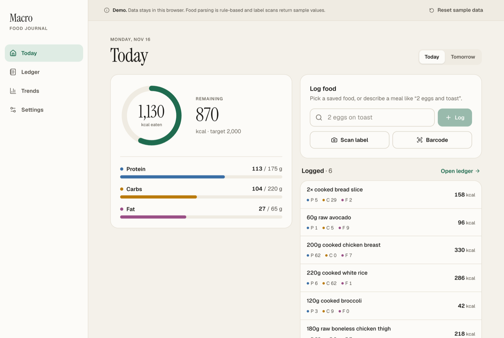
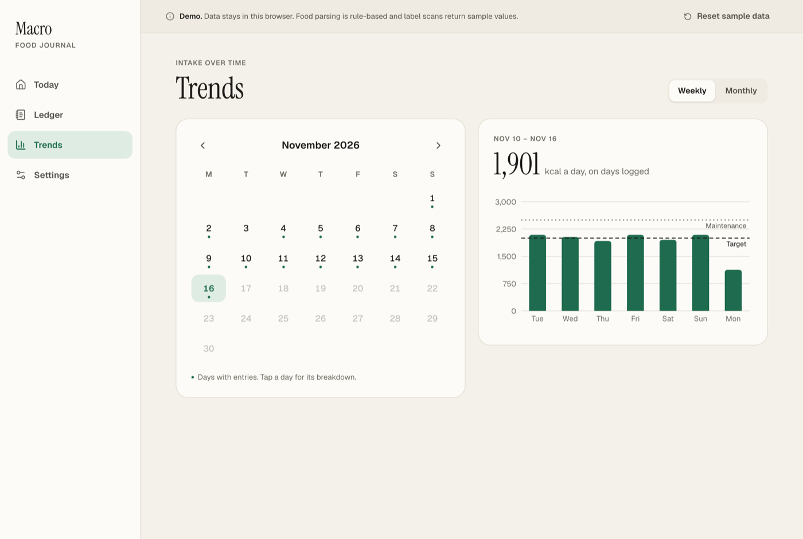
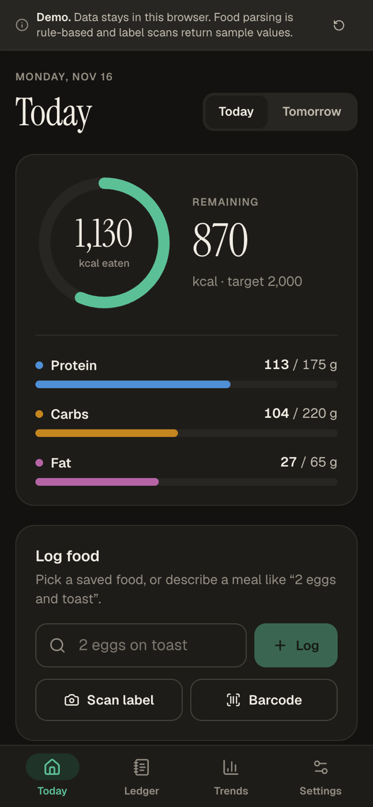
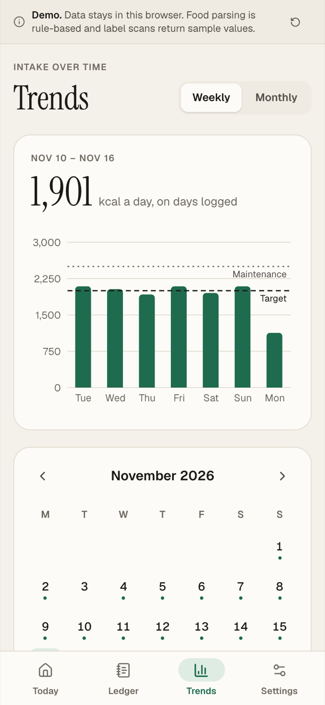

# Macro Tracker

[](https://macro-tracker-app-hazel.vercel.app)


A mobile-first calorie and macro tracker. Log food by typing what you ate, scanning a barcode or photographing a nutrition label, check the numbers, and watch your day fill up. Installable as a PWA, with light and dark themes and a layout that adapts from phone to desktop.

**This repository is the demo build.** It runs entirely in the browser on seeded sample data, so there is nothing to sign up for and no keys to configure. Anything you log is stored in your own browser's `localStorage` and never leaves your device.

| Today | Trends |
|---|---|
|  |  |

<p>
  
  
</p>

## Try it

The quickest way is the [live demo](https://macro-tracker-app-hazel.vercel.app); it works well on a phone too. To run it yourself:

```bash
git clone https://github.com/Itsraza099/Macro_Tracker_App.git
cd Macro_Tracker_App
npm install
npm run dev
```

Open http://localhost:3000. Things worth trying:

- On **Today**, type `180g raw chicken thigh`, `2 eggs` or `a banana` and press **Log**. Review the numbers in the sheet, then confirm.
- Press **Barcode** to scan a real product barcode. This is the one live lookup: it queries the public [Open Food Facts](https://world.openfoodfacts.org) API.
- Open **Ledger** to step through previous days, expand an entry, or delete it.
- Open **Trends** for the calendar, the rolling seven-day chart, and the monthly deficit.
- In **Settings**, change your goals or add your own foods to the dictionary.
- Use **Reset sample data** in the banner at the top to start over.

## What it does

- **Natural-language logging.** `180g raw chicken thigh` becomes a food, a quantity, a unit (grams or item count) and a raw or cooked state.
- **Verify before saving.** Every log, however it was captured, opens an editable sheet first. Nothing is written until you confirm.
- **Food dictionary.** Verified per-100g (or per-item) values are saved and reused, so repeat foods are exact instead of estimated. Full create, edit and delete in Settings.
- **Barcode and label capture.** Barcodes resolve through Open Food Facts. Labels are read by a vision model in the full version.
- **Goals and progress.** A calorie ring, protein, carbs and fat bars against your targets, and the amount remaining. Over-target states are flagged.
- **Plan ahead.** A Today and Tomorrow switch lets you log tomorrow's meals in advance.
- **Trends.** A calendar marking days with entries, a rolling seven-day intake chart against maintenance and target lines, and a cumulative monthly deficit or surplus. Daily energy expenditure can replace the flat maintenance figure.
- **Responsive and themed.** Bottom tab bar on phones, sidebar on desktop, and light and dark themes that follow the system setting.

## How the demo differs from the full app

The full version of this app uses a Postgres database and two AI services. This demo swaps each for a local stand-in, behind the same interfaces, so the interface code is identical in both.

| Concern | Full app | This demo |
|---|---|---|
| Data storage | Supabase (Postgres) | `localStorage`, seeded on first visit |
| Parsing "180g raw chicken thigh" | LLM (Llama 3.1 via Groq) | Rule-based parser plus dictionary lookup |
| Foods not in the dictionary | LLM macro estimate | Small built-in table of common foods; otherwise a clear message |
| Reading nutrition labels | Vision model (Gemini) | Returns fixed sample values |
| Barcode lookup | Open Food Facts | Open Food Facts (live) |

The swap happens in one place. `src/lib/demo/install.ts` intercepts every same-origin `/api/*` request in the browser and answers it from `src/lib/demo/api.ts`, which implements the same endpoints and response shapes as the real server routes. The data model of the full version is in [`docs/production-schema.sql`](docs/production-schema.sql).

## Tech stack

Next.js 15 (App Router), React 19, TypeScript, Tailwind CSS v4, Recharts, `@zxing/browser` for barcode reading, `lucide-react` icons, and `@ducanh2912/next-pwa` for installability and offline support.

## Project structure

```
src/
├── app/
│   ├── page.tsx            Today: calorie ring, macro bars, logging, day's entries
│   ├── ledger/page.tsx     Ledger: browse any day, expand and delete entries
│   ├── trends/page.tsx     Trends: calendar, weekly chart, monthly balance
│   ├── settings/page.tsx   Settings: goals and the food dictionary
│   ├── layout.tsx          Fonts, navigation, demo banner
│   └── globals.css         Design tokens (light and dark) and shared component styles
├── components/             AppNav, Sheet, LogDrawer, Toast, BarcodeScanner, shared UI
└── lib/
    ├── types.ts            Shared data shapes
    ├── dates.ts            Date helpers
    └── demo/               The in-browser backend: store, seed data, parser, API, fetch shim
docs/
└── production-schema.sql   Data model of the full version
```

## Design notes

- All colour comes from CSS custom properties in `globals.css`. Dark mode redefines the same tokens, and no component hard-codes a colour.
- The three macro colours were checked for colour-blind separation in both themes, and every macro also carries a text label.
- Controls are at least 44px tall on touch screens, and inputs use 16px text so iOS does not zoom on focus.
- Motion respects `prefers-reduced-motion`.

## Scripts

```bash
npm run dev     # development server
npm run build   # production build (static output)
npm start       # serve the production build
```

## License

MIT. See [LICENSE](LICENSE).
